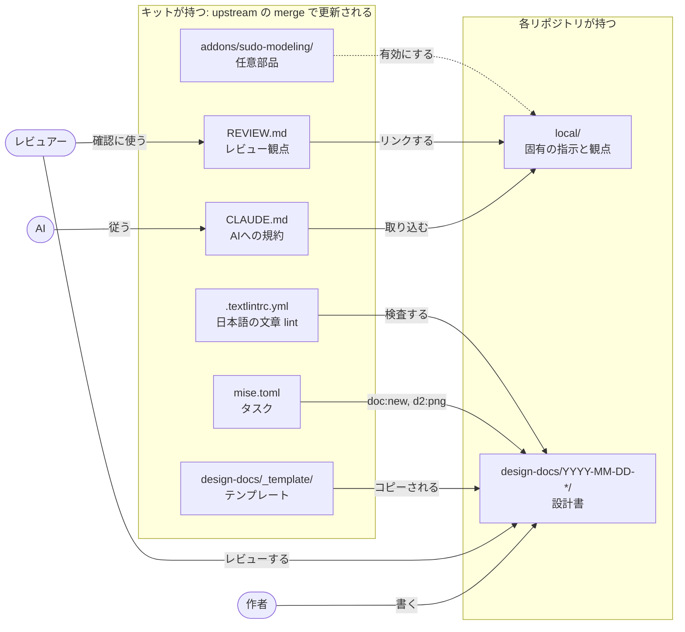

# design-doc-kit

Design Doc を書き、レビューするためのリポジトリの土台です。AIに作者の判断を代行させないことを前提にしています。

[English](https://github.com/nitaking/design-doc-kit/tree/main)

## 考え方

AIに設計書を任せると、作者が決めていない業務ルールや採用理由まで、もっともらしく埋まります。このキットは、AIの役割を「作者への質問」と「確認できた内容の整理」に限り、未決事項を未決のまま残します。

AI向けの制約は [CLAUDE.md](CLAUDE.md)、レビューの観点は [REVIEW.md](REVIEW.md) にあります。

## 含まれるもの



## 使い方

GitHub の「Use this template」からリポジトリを作ります。[mise](https://mise.jdx.dev/) が必要です。

```shell
mise install
pnpm install
mise run doc:new <slug>     # design-docs/YYYY-MM-DD-<slug>/README.md を作成
mise run textlint:diff      # 変更した Markdown を検査
mise run d2:png             # 変更した .d2 を PNG に変換
```

Design Doc の書き方は [design-docs/README.md](design-docs/README.md) を参照してください。

## リポジトリ固有の設定

このキットが持つファイルは編集せず、固有の内容は `local/` に書きます。こうしておくと、キットの更新を取り込むときに衝突しません。

| 書く内容 | 場所 |
| --- | --- |
| AIへの固有の指示 | [local/CLAUDE.md](local/CLAUDE.md) |
| 固有のレビュー観点 | [local/REVIEW.md](local/REVIEW.md) |
| 自分たちの README | `.github/README.md` |

## 更新の取り込み

```shell
git remote add upstream https://github.com/nitaking/design-doc-kit.git   # 初回のみ
mise run kit:update        # upstream/ja を取り込む
```

## ライセンス

- 設定ファイルとタスク定義: [MIT](LICENSE)
- 規約とテンプレートの文面（Markdown）: [CC BY 4.0](LICENSE-CC-BY-4.0)

