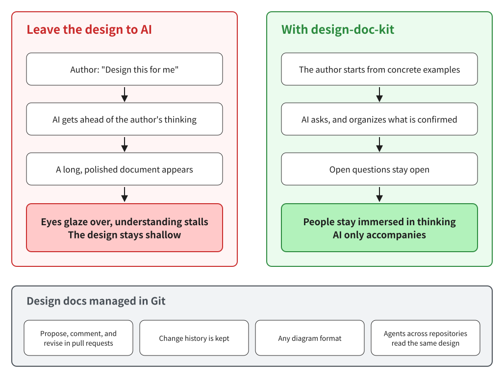
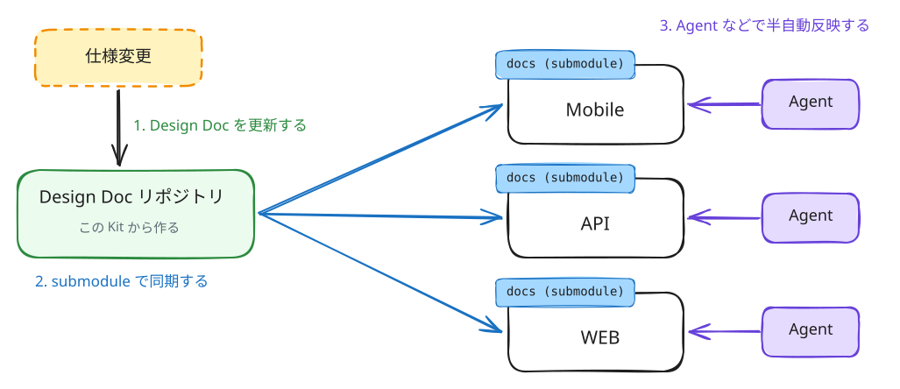

# design-doc-kit

[](https://github.com/nitaking/design-doc-kit/actions/workflows/kit.yml)
[](LICENSE)
[](https://github.com/new?template_owner=nitaking&template_name=design-doc-kit)

A repository template for writing and reviewing design docs. Its purpose is to keep AI from making the author's decisions.

[日本語](https://github.com/nitaking/design-doc-kit/tree/ja)



## Why this exists

### Design docs × Notion: the problems

- The diagrams Notion renders are Mermaid
  - Commenting on part of a diagram is awkward
- When the commented part is changed, the comment is lost
- Diagrams other than Mermaid are hard to render
- Version control is hard

We wanted to exchange proposals, comments, and revisions the way pull requests allow, and to merge into develop.

### Design docs × Git: what got better

- Applied as a submodule, it became easier to let AI coding agents run on their own across multiple repositories
- In reviews too, agents can be used with consistent specifications and context
- For people as well, it became easier to reflect the design
- It is especially effective for designs with clear inputs and outputs, such as databases and APIs

### Designing with AI agents: the problems

- Working out a design by talking it through with AI became easier. On the other hand, AI gets ahead of the author's thinking, so the design becoming shallow turned into a risk
- With little design experience, or with experience but no time to think, it is hard to get out of the bias of a proposal once you have seen it
- Design is where understanding is needed most, and AI output that the eyes slide over gets in the way of understanding

### What this kit aims for

After these experiences, this kit sets up a format in which people can immerse themselves in thinking, and AI does not design and only accompanies.

The constraints for AI are in [AGENTS.md](AGENTS.md), and the review viewpoints are in [REVIEW.md](REVIEW.md).

## How it differs from similar tools

This kit is not a tool that has AI write the design doc. The author writes it; AI only asks questions and reviews.

**vs. spec-driven development** ([Spec Kit](https://github.com/github/spec-kit), [OpenSpec](https://github.com/Fission-AI/OpenSpec), [cc-sdd](https://github.com/gotalab/cc-sdd), [Tsumiki](https://github.com/classmethod/tsumiki)) — AI writes the requirements, design, and tasks; people approve them, and agents implement. Fast, but unknowns get filled with AI's guesses. `/speckit.specify` in Spec Kit instructs the agent to "make informed guesses based on context and industry standards". With this kit the author writes, and anything the author has not answered stays open.

**vs. skills where AI asks questions** ([grill-me](https://github.com/mattpocock/skills), brainstorming in [superpowers](https://github.com/obra/superpowers)) — AI keeps asking to draw out the author's thinking. Close in spirit to this kit, and they can be used together. grill-me leaves no files; brainstorming has AI write the design doc at the end. This kit adds the foundation for the author to write down what was drawn out, review it in pull requests, and distribute it to multiple repositories.

**vs. ADR tools** ([MADR](https://github.com/adr/madr), [adr-tools](https://github.com/npryce/adr-tools), [Log4brains](https://github.com/thomvaill/log4brains)) — They record and publish decisions people wrote, and say nothing about how AI is used. This kit ships constraints for AI ([AGENTS.md](AGENTS.md)) and review viewpoints ([REVIEW.md](REVIEW.md)).

**vs. Notion and other wikis** — See "Why this exists". We moved to Git for comments on part of a diagram, comments that survive edits, and version control.

## What is included


The Japanese edition on the [`ja` branch](https://github.com/nitaking/design-doc-kit/tree/ja) is the original text. It also includes textlint rules for Japanese prose.

## Usage

Create a repository from "Use this template" on GitHub. [mise](https://mise.jdx.dev/) is required.

The template is created from the English edition (`main`). For the Japanese edition, run `KIT_BRANCH=ja mise run kit:update` once after creating the repository.

```shell
mise install
mise run doc:new <slug>     # creates design-docs/YYYY-MM-DD-<slug>/README.md
mise run d2:png             # converts changed .d2 files to PNG
```

For how to write a design doc, see [design-docs/README.md](design-docs/README.md).

## Referring to it from multiple repositories

Add the design doc repository as a submodule to each repository that refers to it.



```shell
# In the repository that refers to it
git submodule add <URL of the design doc repository> shared-docs

# Pull in design updates
git submodule update --remote shared-docs
git add shared-docs
git commit -m "docs(shared-docs): update to latest"
```

## Repository-specific settings

Do not edit the files this kit owns. Write repository-specific content in `local/`. Updating the kit overwrites the files it owns, so edits to them are lost.

| What to write | Where |
| --- | --- |
| Instructions for AI specific to the repository | [local/CLAUDE.md](local/CLAUDE.md) |
| Review viewpoints specific to the repository | [local/REVIEW.md](local/REVIEW.md) |
| Your own README | `.github/README.md` |

## Pulling updates

```shell
mise run kit:update
```

Fetches the latest kit and overwrites the files the kit owns. `local/` and your design docs under `design-docs/` are untouched. Review the result with `git diff` and commit it.

`KIT_BRANCH` also accepts a tag. `KIT_BRANCH=v0.1.0` pins that version. Changes are listed in [Releases](https://github.com/nitaking/design-doc-kit/releases).

If you maintain a fork of the kit for your organization, point `KIT_REPO=<URL of the fork>` at it.

On every push, CI creates a repository from the kit and checks that `doc:new` and `kit:update` work ([kit.yml](.github/workflows/kit.yml)).

## Contributing

See [CONTRIBUTING.md](CONTRIBUTING.md).

## License

[MIT](LICENSE)
