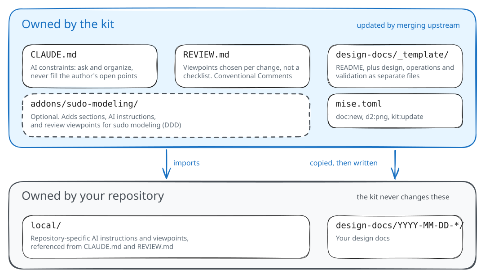

# design-doc-kit

Design Doc を書き、レビューするためのリポジトリの土台です。AIに作者の判断を代行させないことを前提にしています。

[English](https://github.com/nitaking/design-doc-kit/tree/main)


## なぜ作ったか

### Design Doc × Notion の問題

- Notion では描画されるのが Mermaid
  - 図の一部にコメントしにくい
- コメントした箇所に変更が入ると、コメントが吹き飛ぶ
- Mermaid 以外の図のレンダリングがしにくい
- バージョン管理がしにくい

Pull Request のように、提案とコメントと修正のやりとりがしたい。また、develop へのマージがしたい。

### Design Doc × Git で良くなったこと

- submodule で適用すると、複数のリポジトリ間での AI Agent Coding が自走させやすくなった
- レビュー時にも、一貫性のある仕様、コンテキストをもたせた Agent の利用ができる
- 人からみても、設計の反映がさせやすくなった
- 特に in/out の明確な、DB や API の設計は効果的

### AI Agent との設計の問題

- AIと壁打ちしながらの設計の詰めがしやすくなった反面、AIが思考の先取りをしてしまうため、設計の深さが浅くなる点がリスクになった
- 設計の経験が少なかったり、経験があっても考える時間が取れないと、一度目にした案のバイアスから抜け出しにくい
- また、最も理解が求められる設計において、AIによる目が滑る出力テキストは、脳の理解を妨げる

### この Kit で目指すこと

このような出来事があり、今回、「人間が思考に没頭できる」「AIは設計を行わない、伴走のみを行う」フォーマットを整備した。

AI向けの制約は [CLAUDE.md](CLAUDE.md)、レビューの観点は [REVIEW.md](REVIEW.md) にあります。

## 似たツールとの違い

似たツールは3つの系統に分けられます。この Kit は、どの系統とも AI の役割が異なります。

| 系統 | 例 | AI の役割 | この Kit との違い |
| --- | --- | --- | --- |
| 仕様駆動開発 | [Spec Kit](https://github.com/github/spec-kit)、[OpenSpec](https://github.com/Fission-AI/OpenSpec)、[cc-sdd](https://github.com/gotalab/cc-sdd)、[Tsumiki](https://github.com/classmethod/tsumiki) | 要件・設計・タスクを AI が生成し、人がレビューして承認する | AI に設計書を書かせない。目的は、エージェントに実装させることではなく、作者が設計を考え、人がレビューすること |
| ADR・docs-as-code | [MADR](https://github.com/adr/madr)、[adr-tools](https://github.com/npryce/adr-tools)、[Log4brains](https://github.com/thomvaill/log4brains) | なし。人が書いた決定を残し、公開する | AI を使う前提で、AI への制約とレビュー観点を同梱する |
| AI が質問するスキル | [grill-me](https://github.com/mattpocock/skills)、[superpowers](https://github.com/obra/superpowers) の brainstorming | 質問して作者の考えを引き出す。grill-me は各質問に推奨回答を付け、brainstorming は最後に AI が設計書を書く | 考えを引き出す点は同じで、併用できる。この Kit は、その結果を残すリポジトリの土台（テンプレート、レビュー観点、PR での運用）を提供する |

仕様駆動開発のツールは、不明な点を AI が推測で埋めて先へ進むことを認めています。たとえば Spec Kit の `/speckit.specify` は、「文脈と業界標準から妥当な推測をする」「要確認の印は最大3つまで」と指示しています。この Kit は逆に、作者が答えていない点を未決のまま残すことを AI に求めます。事実、推測、提案、決定、未決事項を区別して残すことが、設計書の価値だと考えているためです。

## 含まれるもの



## 使い方

GitHub の「Use this template」からリポジトリを作ります。[mise](https://mise.jdx.dev/) が必要です。

```shell
mise install
pnpm install
mise run doc:new <slug>     # design-docs/YYYY-MM-DD-<slug>/README.md を作成
mise run textlint:diff      # 変更した Markdown を検査
mise run d2:png             # 変更した .d2 を PNG に変換
```

Design Doc の書き方は [design-docs/README.md](design-docs/README.md) を参照してください。

## 複数のリポジトリから参照する

Design Doc のリポジトリを、参照する側のリポジトリに submodule として追加します。


```shell
# 参照する側のリポジトリで
git submodule add <Design Doc リポジトリの URL> shared-docs

# 設計の更新を取り込む
git submodule update --remote shared-docs
git add shared-docs
git commit -m "docs(shared-docs): update to latest"
```

## リポジトリ固有の設定

この Kit が持つファイルは編集せず、固有の内容は `local/` に書きます。こうしておくと、Kit の更新を取り込むときに衝突しません。

| 書く内容 | 場所 |
| --- | --- |
| AIへの固有の指示 | [local/CLAUDE.md](local/CLAUDE.md) |
| 固有のレビュー観点 | [local/REVIEW.md](local/REVIEW.md) |
| 自分たちの README | `.github/README.md` |

## 更新の取り込み

```shell
git remote add upstream https://github.com/nitaking/design-doc-kit.git   # 初回のみ
mise run kit:update        # upstream/ja を取り込む
```

## ライセンス

- 設定ファイルとタスク定義: [MIT](LICENSE)
- 規約とテンプレートの文面（Markdown）: [CC BY 4.0](LICENSE-CC-BY-4.0)

