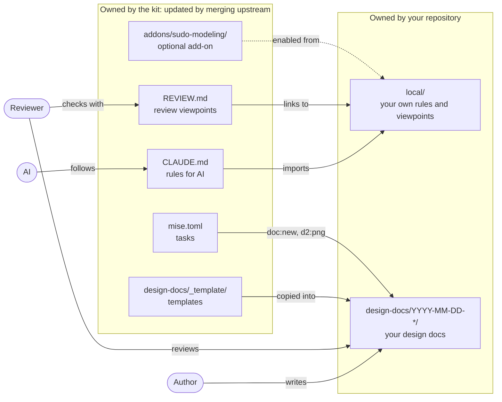

# design-doc-kit

A foundation for repositories where design docs are written and reviewed. It assumes AI must not make the author's decisions.

[日本語](https://github.com/nitaking/design-doc-kit/tree/ja)

## Idea

When a design doc is left to AI, even business rules and rationale the author never decided get filled in plausibly. This kit limits the role of AI to asking the author questions and organizing what has been confirmed, and leaves open questions open.

## What is included



The Japanese edition on the [`ja` branch](https://github.com/nitaking/design-doc-kit/tree/ja) is the original text. It also includes textlint rules for Japanese prose.

## Usage

Create a repository from "Use this template" on GitHub. [mise](https://mise.jdx.dev/) is required.

```shell
mise install
mise run doc:new <slug>     # creates design-docs/YYYY-MM-DD-<slug>/README.md
mise run d2:png             # converts changed .d2 files to PNG
```

For how to write a design doc, see [design-docs/README.md](design-docs/README.md).

## Repository-specific settings

Do not edit the files this kit owns. Write repository-specific content in `local/`. This avoids conflicts when you pull updates from the kit.

| What to write | Where |
| --- | --- |
| Instructions for AI specific to the repository | [local/CLAUDE.md](local/CLAUDE.md) |
| Review viewpoints specific to the repository | [local/REVIEW.md](local/REVIEW.md) |
| Your own README | `.github/README.md` |

## Pulling updates

```shell
git remote add upstream https://github.com/nitaking/design-doc-kit.git   # first time only
mise run kit:update        # merges upstream/main
```

## License

- Configuration files and task definitions: [MIT](LICENSE)
- Text of the rules and templates (Markdown): [CC BY 4.0](LICENSE-CC-BY-4.0)
